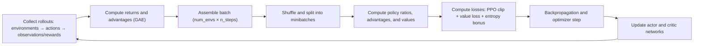
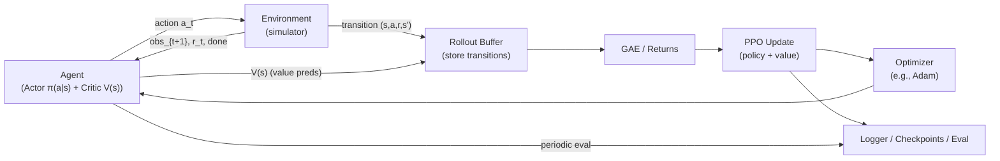
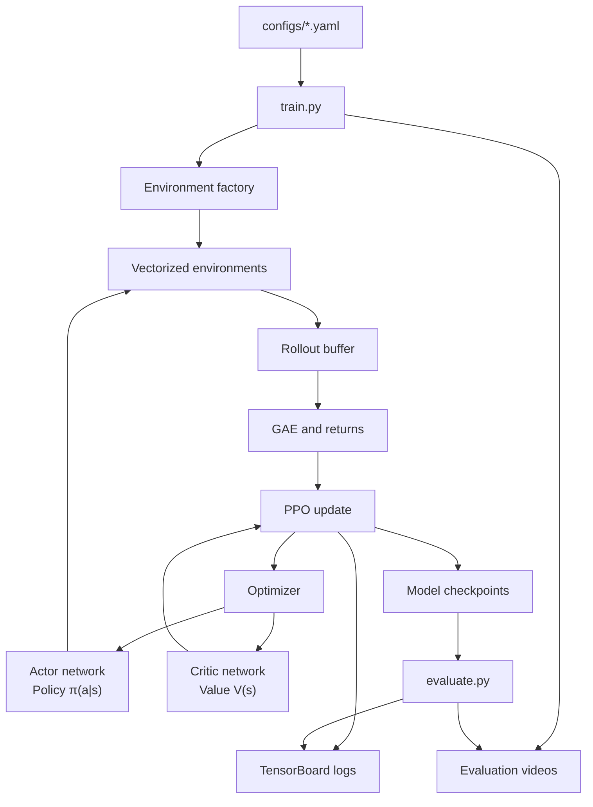

# HumanoidLab - Architecture, design decisions, and developer notes

This document explains the repository layout, the key design choices made for the PPO implementation, a file-by-file description, and practical notes for a research engineer who wants to reproduce, extend, or debug experiments.

Summary: HumanoidLab implements a standard on-policy PPO (Proximal Policy Optimization) training pipeline with configuration-driven experiments. The code emphasizes transparency and reproducibility: hyperparameters live in YAML (YAML Ain't Markup Language) configs, checkpoints and TensorBoard logs are saved automatically, and evaluation utilities create videos for qualitative inspection.

## Design goals and trade-offs

- Minimal, readable implementation focused on research iterations rather than extreme performance.
- Config-driven experiments: keep code paths generic and move experiment-level choices to `configs/` so runs are easy to reproduce and compare.
- Deterministic-ish checkpoints and logging: save configs and seeds with runs so experiments can be partially reconstructed.
- Practical defaults: moderate policy size, advantage normalization, and observation/reward normalization to work well across many continuous-control tasks.

Trade-offs:
- We prioritize clarity over micro-optimizations (e.g., simple NumPy/torch usage instead of aggressive JIT (Just-In-Time) / XLA (Accelerated Linear Algebra)).
- Synchronous vectorized environments (few envs per process) are simpler to debug but may yield lower throughput compared to highly parallel setups.

## PPO implementation overview (algorithmic details)

High-level training loop:

1. Create `num_envs` parallel environments and collect `n_steps` from each environment (total batch = `num_envs * n_steps`).
2. Compute returns and advantages using GAE (Generalized Advantage Estimation; gamma, gae_lambda).
3. For `n_epochs` times, shuffle the batch and perform minibatch Stochastic Gradient Descent (SGD) steps of size `minibatch_size`.
4. Update policy and value networks with combined loss: clipped policy loss (PPO-clip), optional value loss clipping, and entropy bonus.
5. Optionally anneal learning rate linearly over `total_timesteps`.

Key hyperparameters and rationale:
- `n_steps` (2048): balances between variance in gradient estimates and memory; larger `n_steps` increases sample efficiency per update but worsens non-stationarity.
-- `num_envs` (4 by default): small for easier debugging; increase to 8–32 for throughput if CPU (Central Processing Unit) / GPU (Graphics Processing Unit) permit.
- `n_epochs` (10): reuses sampled data multiple times - standard PPO practice.
- `minibatch_size` (64): trades off gradient noise vs. compute.
- `clip_coef` (0.2): typical PPO clipping parameter to limit policy updates.
- `clip_vloss`: using clipped value loss reduces large value updates and stabilizes training for high-variance environments.
- `ent_coef` (0.0 default): no entropy bonus by default; enabling small positive values (1e-3–1e-2) helps exploration on harder tasks.

Normalization and numerical stability:
- Observation normalization and reward normalization are enabled in configs; they are critical for environments with varying observation scales.
- Advantage normalization (zero mean, unit var) is applied before policy updates to stabilize learning.

Convergence expectations:
- For complex humanoid tasks, expect more variance and longer training (several million environment steps). The config's default `total_timesteps` may be sufficient in many seeds, but runs can still fail due to random seeds or reward shaping.

## Key terms and PPO update diagram

Below are concise, research-oriented definitions of the most commonly referenced terms in this codebase and what to inspect during training.

Policy clip (PPO-clip): the clipped surrogate objective used by Proximal Policy Optimization to limit how far the new policy's action probabilities may diverge from the old policy. Formally, the clipped ratio is

$r(\theta)=\frac{\pi_\theta(a\mid s)}{\pi_{\theta_{\text{old}}}(a\mid s)}$

and the surrogate objective uses the clipped term min\(r(\theta)\,A, \operatorname{clip}(r(\theta), 1-\epsilon, 1+\epsilon)\,A\), where $\epsilon$ is `clip_coef` and $A$ is the estimated advantage. This prevents large destructive policy updates.

- Value loss: the loss for the value (critic) network, typically mean-squared error between predicted state-values and bootstrapped returns. With `clip_vloss` the value error is clipped to avoid very large, destabilizing updates similar in spirit to the policy clip.

- Entropy (entropy bonus): the expected policy entropy added to the objective (weighted by `ent_coef`) encouraging stochasticity and exploration. Low entropy can cause premature convergence to suboptimal deterministic policies.

- Advantage: an estimate of how much better an action performed compared to the baseline value for a state. Commonly computed with GAE (see below). Advantage normalization (zero mean, unit variance) is applied to stabilize gradient magnitudes.

- GAE (Generalized Advantage Estimation): a method to compute a temporally-smoothed advantage estimate using a decay parameter `gae_lambda` and discount `gamma`. GAE interpolates between high-bias low-variance (TD) and low-bias high-variance (Monte-Carlo) estimates.

- Clip fraction: the fraction of minibatch updates where the policy ratio r(θ) lies outside [1-ε, 1+ε]. High clip fraction may indicate the step size is too large or the policy is changing rapidly.

- Approx KL (approx_kl): an empirical estimate of the Kullback-Leibler divergence between the old and new policy collected during updates. Monitoring `approx_kl` helps detect when the policy is drifting too far; some implementations use a `target_kl` to early-stop updates.

- Explained variance: measures how well the critic explains return variance; values close to 1 mean the value function predicts returns well, values near 0 or negative indicate poor or inverted predictive power.

`log_std` / action std: parameterization of action noise. `log_std_init` sets the initial log standard deviation; $\sigma = e^{\mathrm{log\_std}}$. For the Humanoid config default, $\sigma = e^{-0.5} \approx 0.61$. Smaller initial $\sigma$ reduces early action noise but can reduce exploration.

### PPO update loop

The PPO training data flow:

Use these terms when inspecting TensorBoard scalars: `policy_loss`, `value_loss`, `entropy`, `approx_kl`, `clip_fraction`, and `explained_variance`.

## Agent–Environment interaction

A compact diagram showing the per-step interaction between the agent (actor + critic), the environment, and the training components that consume rollouts.

## Config walkthrough - `configs/humanoid_v5.yaml`

This repository includes `configs/humanoid_v5.yaml` as the canonical hard-control example. Below are the exact settings (copied from the YAML) and the rationale for each choice.

- `exp_name`: `ppo_humanoid_v5` - descriptive run name.
- `env_id`: `Humanoid-v5` - a high-dimensional locomotion task; requires larger capacity and more samples than Ant.
- `seed`: 1 - fixed default; vary for final experiments and reporting.
- `device`: `auto` - picks CUDA when available.

- Vectorized rollout
	- `num_envs`: 16 - larger parallelism for better sample diversity and throughput on multi-core machines.
	- `n_steps`: 512 - steps per environment; with `num_envs=16` this yields a batch of 8192 samples per update, a good trade-off between variance and update frequency.
	- `total_timesteps`: 15000000 (15M) - increased budget for complex humanoid learning.

- Optimization and PPO
	- `learning_rate`: 3e-4, `anneal_lr`: true - standard baseline with linear decay over training.
	- `n_epochs`: 10, `minibatch_size`: 64 - common PPO settings to reuse data while keeping minibatches small enough for stable SGD.
	- `max_grad_norm`: 0.5 - gradient clipping to guard against instability.
	- `clip_coef`: 0.2, `clip_vloss`: true - PPO clipping for policy and optionally for value updates.
	- `ent_coef`: 0.001 - small positive entropy coefficient to aid exploration on a hard exploration task like Humanoid.
	- `vf_coef`: 0.5 - value loss scaling.
	- `normalize_advantage`: true - advantage normalization before policy updates.

- Normalization & model
	- `normalize_obs`: true, `normalize_reward`: true - required for robust training across varying observation scales and rewards.
	- `clip_obs`: 10.0, `clip_reward`: 10.0 - guardrails for extreme values.
	- `hidden_sizes`: [256, 256], `activation`: `tanh` - network capacity appropriate for 300+ dimensional observations.
	- `log_std_init`: -0.5 - initial action std = exp(-0.5) ≈ 0.61; more conservative than sigma=1.0 to reduce early action noise.

- Logging & checkpointing
	- `log_dir`: `logs`, `ckpt_dir`: `models`, `video_dir`: `videos`
	- `save_every_iters`: 25, `log_every_iters`: 1 - frequent checkpoints and scalars help diagnose training early.

Rationale summary: This config is tuned for harder humanoid control: increased parallelism (`num_envs=16`) with shorter `n_steps` gives large, frequent batches (8192 samples) for stable updates; `total_timesteps=15M` provides a larger budget; `ent_coef=0.001` encourages exploration while `log_std_init=-0.5` reduces extremely noisy early actions. Normalization and gradient clipping prioritize stability on this sensitive task.

## Overall architecture

High-level system architecture (components and data flow). This diagram shows how configs, training code, environments, models, and logging interact.

Notes:
- `train.py` wires the pipeline together using `configs/*.yaml` for hyperparameters.
- Vectorized environments feed batches into the `Buffer` which are processed by `GAE` and consumed by the `PPO` update loop.
- Checkpoints and logs are written frequently; `evaluate.py` consumes checkpoints to produce videos and eval metrics.

## File-by-file explanation (`src/`)

-- `train.py`
	- Entry point for training runs. Loads a YAML config, seeds RNGs (random number generators), creates log and checkpoint directories, builds vectorized environments, initializes the agent and optimizer, and runs the main training loop. Also handles checkpoint saving, periodic evaluation hooks, and graceful termination.

- `ppo.py`
	- Contains the `PPOAgent` (or similarly named) class which wraps policy/value networks, optimizer, the update() method implementing the PPO loss (policy clip, value loss, entropy), and convenience methods for saving/loading checkpoints.

-- `actor.py`
	- The policy network implementation. For continuous actions this typically outputs a mean vector and a parameterization of std (e.g., `log_std` per action or state-dependent std). Activation functions and hidden sizes are controlled via configs. Keep this modular to swap architectures (Multi-Layer Perceptron (MLP) → residual → attention).

-- `critic.py`
	- The value network (state-value estimator). Often a Multi-Layer Perceptron (MLP) sharing some architecture with the actor, or a separate head attached to the policy network.

- `buffer.py`
	- A lightweight rollout storage buffer that accumulates transitions during environment interaction and exposes batched tensors for advantage/return computation and later mini-batching for updates.

- `gae.py`
	- Implementation of Generalized Advantage Estimation (GAE) to compute temporal-difference residuals and discounted returns using `gamma` and `gae_lambda`.

- `utils.py`
	- Helper functions: seeding, logging wrappers, config loading, checkpoint helpers, environment factory functions (wrappers for normalization), device utilities, and small visual helpers for rendering videos.

- `evaluate.py`
	- Script for running deterministic rollouts from saved checkpoints. Saves videos to `videos/` and prints per-episode returns and lengths. Useful for qualitative inspection and sanity checks.

## Data flow and interactions

- `train.py` uses the env factory in `utils.py` to instantiate `num_envs` parallel environments.
- Each step, the agent's policy (from `actor.py`) is queried to produce actions for all envs; envs step and return obs, rewards, dones.
- Transitions are appended to `buffer.py`. After `n_steps` the buffer is used to compute advantages via `gae.py`.
- The PPO update loop (in `ppo.py`) pulls minibatches from the buffer and performs `n_epochs` passes.

## Practical notes, debugging checklist, and learnings

Common issues and how to diagnose them:

- No learning / flat returns
	- Check observation normalization: wrong scales or missing normalization can kill learning.
	- Check reward scale: extremely small or large rewards need clipping or rescaling.
	- Verify that advantages are non-trivial (not always zero) - if advantage variance is tiny, gradients vanish.

- Exploding gradients / NaNs
	- Use `max_grad_norm` to clip gradients (config default 0.5).
	- Lower learning rate temporarily and enable gradient clipping.

- Very noisy training across seeds
	- Increase `num_envs` to reduce variance per update and increase minibatch diversity.
	- Run several seeds and average curves; log per-seed results in `docs/Experiments.md`.

Good practices learned from running many experiments:

- Save the full config alongside each run (serialize YAML into the `models/<run>/` folder) so checkpoints are self-describing.
- Use TensorBoard scalars for: episode return, policy loss, value loss, entropy, approx_kl, clip_fraction, explained_variance. Plotting these side-by-side helps spot failure modes quickly.
- Small architecture changes (hidden sizes, activation) can massively affect sample efficiency. Start with reasonable defaults and scale up capacity for harder tasks.

## Hyperparameter tuning suggestions

- If the agent underfits (low returns): increase `hidden_sizes`, increase `total_timesteps`, or increase `num_envs`.
- If the agent overfits or is unstable: reduce learning rate, increase `max_grad_norm`, enable `clip_vloss`.
- For exploration-challenging tasks: set `ent_coef` to a small positive value (1e-3–1e-2), or use a learning rate schedule.

## Reproducibility checklist for publication

- Commit the exact `configs/` used and log the Git SHA in `docs/Experiments.md`.
- Save seeds, checkpoint paths, and final evaluation scripts used to produce reported numbers.
- For large runs, publish TensorBoard logs and sample videos as supplementary materials rather than storing large binaries in Git.

## Next steps and extensions

- Add optional support for mixed-precision training for speedups on modern GPUs.
- Add an opt-in distributed sampler (multiple processes) for faster data collection and larger `num_envs`.
- Provide a small `examples/` directory with a tiny environment and precomputed checkpoint for quick demos.

---
If you'd like, I can (a) add this high-level summary to `README.md`, (b) generate a `CONTRIBUTING.md` template, or (c) add inline docstrings to each `src/` file that match this documentation. Which should I do next?
